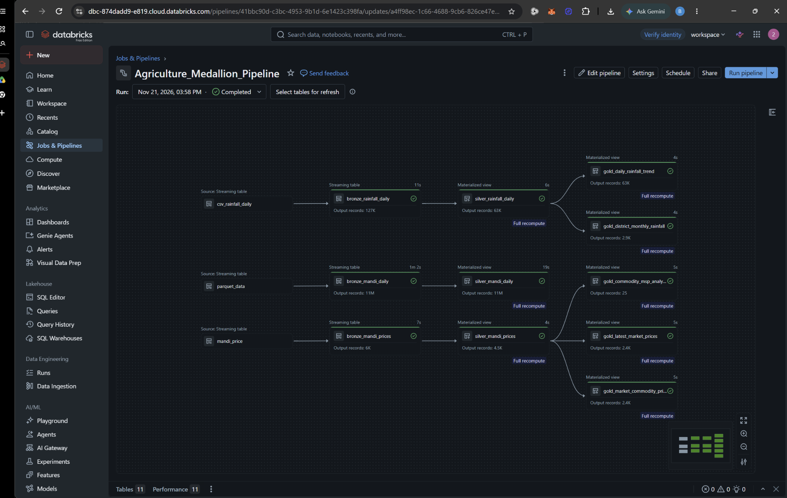
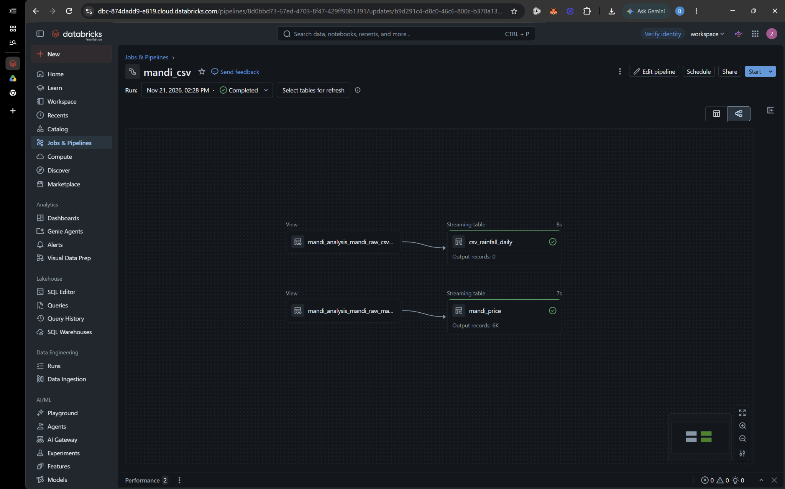

# Agriculture Intelligence — Mandi Prices & Rainfall

An agricultural data engineering and Power BI project combining Indian mandi market prices with district-level rainfall information. Data is processed in **Databricks using Medallion Architecture** and presented through a four-page Power BI dashboard.

## Project at a glance

- **Market data:** historical mandi prices and recent AGMARKNET records.
- **Rainfall data:** daily IMD rainfall observations.
- **Data platform:** Databricks, Apache Spark / PySpark, Python and Unity Catalog.
- **Reporting:** Power BI Desktop, using curated Gold-layer tables.

## Data sources

| Dataset | Source | Documented coverage / volume | Relevance |
|---|---|---:|---|
| Historical mandi prices | [Hugging Face — Mandi India Daily Prices](https://huggingface.co/datasets/DHIVAKARNAIDUSUNKARI/mandi-india-daily-prices-2001-2026) | 2024: 5,527,169; 2025: 5,827,604 records | Relevant for historical commodity and market-price analysis. Verify upstream provenance and license because it is hosted by a third party. |
| Recent mandi prices | [AGMARKNET](https://agmarknet.gov.in/) | 1,528 records documented | Relevant official Government of India source for recent mandi-market information. |
| Daily rainfall | [National Water Data Portal — IMD rainfall](https://nwdp.nwic.gov.in/en/dataset/rainfall-daily-imd) | 63,287 records documented; 19 Aug–14 Nov 2026 | Relevant for rainfall monitoring. Price/rainfall correlation requires overlapping dates and matching locations. |

**Coverage note:** The historical mandi snapshots cover 2024–2025, while the documented rainfall extract covers 2026. They cannot be directly correlated over the same dates. The rainfall source README reports 63,287 records; the Databricks pipeline screenshot shows approximately 127K Bronze records and 63K Silver records. Confirm the raw-file and table counts when reconciling ingestion and deduplication.

## Databricks structure

**Catalog:** `mandi_analysis`  
**Schema:** `mandi_raw`

The pipeline code is organized in the Workspace under:

```text
Agriculture_Medallion_Pipeline/
└── transformations/
    ├── 01_bronze.py
    ├── 02_silver.py
    └── 03_gold.py
```

### Medallion layers

| Layer | Purpose | Main work |
|---|---|---|
| **Bronze** | Ingest raw source tables | Creates Bronze streaming tables and adds source/load lineage columns. |
| **Silver** | Clean and standardize | Standardizes column names, trims text, parses dates, casts numeric and percentage fields, filters invalid rainfall keys, removes selected metadata columns, and deduplicates. |
| **Gold** | Prepare analytics tables | Creates materialized views for market-price summaries, MSP comparison, latest prices, and rainfall analytics. |

### Pipeline outputs

**Bronze tables**
- `bronze_mandi_daily`
- `bronze_mandi_prices`
- `bronze_rainfall_daily`

**Silver tables**
- `silver_mandi_daily`
- `silver_mandi_prices`
- `silver_rainfall_daily`

**Gold tables**
- `gold_market_commodity_price_summary`
- `gold_commodity_msp_analysis`
- `gold_latest_market_prices`
- `gold_district_monthly_rainfall`
- `gold_daily_rainfall_trend`

### Pipeline screenshots

**Main Agriculture Medallion pipeline**



**Separate mandi CSV ingestion pipeline**



The screenshots show a completed run in Databricks on **21 Nov 2026**. The main pipeline graph displays the Bronze → Silver → Gold flow and output-record counts. The separate `mandi_csv` pipeline shows its source views and ingestion outputs.

## Power BI dashboard

The Power BI report has four pages:

1. **Mandi Market Intelligence** — coverage KPIs, average price by commodity and state, commodity-group share, and price summary.
2. **Price vs MSP Analysis** — market price compared with MSP, week-on-week trend, price gap, and comparison detail.
3. **Market Explorer** — commodity, commodity-group and state filters; Top 10 markets; minimum/maximum price comparison; detailed market table.
4. **Rainfall Monitor** — actual versus normal rainfall, rainfall categories, monthly comparison, state ranking, and state filter.

The separate Power BI project README documents a PBIP project with a TMDL semantic model, PBIR report, five CSV source files, 8 model tables, 46 measures, 4 report pages and 38 visuals. It also documents a MandiPremium V2 theme, SVG page backgrounds, Power Query cleanup and TopN filtering.

## Power BI project files

```text
MandiRainfallDashboard/
├── MandiRainfallDashboard.pbip
├── MandiRainfallDashboard.SemanticModel/
├── MandiRainfallDashboard.Report/
├── *.csv
└── _build/
    ├── generate_pbip.py
    ├── validate_pbip.py
    └── check_m.py
```

The original report uses a `SourceFolder` parameter for its local CSV files. For the Databricks-connected version, the relevant Power Query source steps are changed to use the Databricks SQL Warehouse connector. Keep existing query names, column names, data types, relationships and measures compatible so the report visuals continue to work.

## Technology stack

- Databricks and Unity Catalog
- Apache Spark / PySpark
- Python and `pyspark.pipelines`
- SQL and Databricks SQL Warehouse
- Power BI Desktop (PBIP, TMDL, PBIR, Power Query)
- CSV and Parquet

## Important validation notes

- Confirm source table names and schemas in Unity Catalog before rerunning the pipeline.
- A successful pipeline run should be checked against the event log and Gold-table row counts.
- Compare Gold-table columns and grain with the existing Power BI queries before replacing CSV sources.
- Validate all report pages, slicers, DAX measures, relationships and visuals after changing the data source.
- Dashboard figures are report snapshots and may change after refresh.

## Repository layout

```text
Agriculture_Intelligence/
├── transformations/
│   ├── 01_bronze.py
│   ├── 02_silver.py
│   └── 03_gold.py
├── docs/
│   └── images/
│       ├── agriculture-medallion-pipeline.png
│       └── mandi-csv-ingestion-pipeline.png
├── MandiRainfallDashboard/
│   ├── MandiRainfallDashboard.pbip
│   ├── MandiRainfallDashboard.SemanticModel/
│   └── MandiRainfallDashboard.Report/
└── README.md
```

*The Power BI folder shown above represents the dashboard project. The Databricks transformation files and dashboard project may be maintained in separate repositories or folders.*
